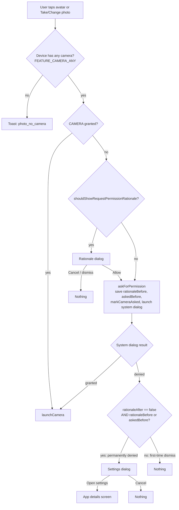
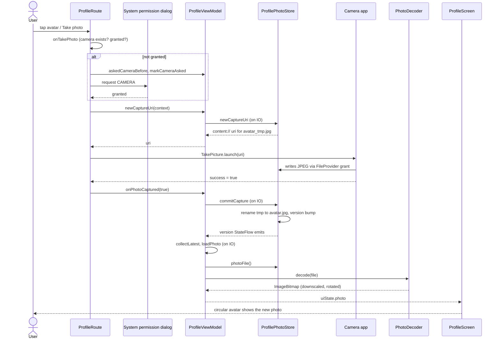

# Feature: Profile photo (camera + CAMERA permission)

## 1. Overview

On the **Profile** screen the header shows a circular avatar (`Dimens.ProfileAvatar` = 72 dp). Without a photo it shows a person icon; with a photo it shows the picture, center-cropped.

What the user can do:

- **Take photo** / **Change photo**: tap the avatar or the text button. The label switches to "Change photo" once a photo exists.
- **Remove photo**: the button appears only when a photo exists.
- **Permission handling**: the app asks for `CAMERA` at the moment the user taps, explains why if Android recommends it, and sends the user to system Settings if the permission was blocked permanently.
- The photo is stored privately in the app's `filesDir` and is deleted on sign-out.

The picture is taken by the system camera app (`ActivityResultContracts.TakePicture`), so the app never opens the camera hardware itself. It still declares and requests `CAMERA`, because declaring it in the manifest makes the camera intent require the grant.

## 3. File map

| File | Role |
|---|---|
| `app/src/main/AndroidManifest.xml` | Declares `CAMERA`, optional camera feature, and the `FileProvider` |
| `app/src/main/res/xml/file_paths.xml` | Tells `FileProvider` which folder (`filesDir/profile/`) it may share |
| `app/src/main/java/com/example/qamqorapp/data/local/ProfilePhotoStore.kt` | Files on disk: temp capture, committed avatar, version flow |
| `app/src/main/java/com/example/qamqorapp/data/local/PhotoDecoder.kt` | `PhotoDecoder` interface and `AndroidPhotoDecoder` (downscale + EXIF rotation) |
| `app/src/main/java/com/example/qamqorapp/data/SettingsRepository.kt` | Persists the "camera permission was asked before" flag |
| `app/src/main/java/com/example/qamqorapp/AppContainer.kt` | Creates `photoStore` and `photoDecoder` |
| `app/src/main/java/com/example/qamqorapp/ui/QamqorFactory.kt` | Injects them into `ProfileViewModel` and `AppShellViewModel` |
| `app/src/main/java/com/example/qamqorapp/ui/profile/ProfileViewModel.kt` | Photo state, capture/remove actions, decoding |
| `app/src/main/java/com/example/qamqorapp/ui/profile/ProfileScreen.kt` | `ProfileRoute` (permission flow) and `ProfileScreen` (avatar UI) |
| `app/src/main/java/com/example/qamqorapp/ui/navigation/AppShellViewModel.kt` | Deletes the photo on sign-out |
| `app/src/main/res/values/strings.xml`, `values-ru/strings.xml` | `photo_*` strings (EN, RU) |
| `app/src/test/java/com/example/qamqorapp/data/local/ProfilePhotoStoreTest.kt` | JVM unit tests for the file logic |

## 4. Step by step

### 4a. Manifest

`app/src/main/AndroidManifest.xml` (lines 4-9)

```xml
<uses-permission android:name="android.permission.INTERNET" />
<uses-permission android:name="android.permission.CAMERA" />

<uses-feature
    android:name="android.hardware.camera.any"
    android:required="false" />
```

- **`CAMERA` permission**: if an app declares `CAMERA` in its manifest, then launching `ACTION_IMAGE_CAPTURE` (which `TakePicture` does) throws a `SecurityException` unless the permission is granted at runtime. So once it is declared, the app must request it.
- **`uses-feature ... required="false"`**: declaring `CAMERA` makes Google Play assume the app needs camera hardware and hide it from devices without one. `required="false"` keeps the app installable on those devices. The code then checks `FEATURE_CAMERA_ANY` at runtime.

`app/src/main/AndroidManifest.xml` (lines 35-43)

```xml
<provider
    android:name="androidx.core.content.FileProvider"
    android:authorities="${applicationId}.fileprovider"
    android:exported="false"
    android:grantUriPermissions="true">
    <meta-data
        android:name="android.support.FILE_PROVIDER_PATHS"
        android:resource="@xml/file_paths" />
</provider>
```

The camera app is a different process and cannot write into this app's private storage (`filesDir`). `FileProvider` hands out a `content://` uri instead. `grantUriPermissions="true"` lets the system give the camera app a temporary read/write grant for that one uri, and `exported="false"` keeps the provider closed to everyone else. The authority `${applicationId}.fileprovider` must match the string built in `AppContainer` (`"${context.packageName}.fileprovider"`).

`app/src/main/res/xml/file_paths.xml` (lines 1-4)

```xml
<?xml version="1.0" encoding="utf-8"?>
<paths>
    <files-path name="profile" path="profile/" />
</paths>
```

Only `filesDir/profile/` is shareable, nothing else in the app's private storage.

### 4b. Dependency wiring

`app/src/main/java/com/example/qamqorapp/AppContainer.kt` (lines 19-27)

```kotlin
class AppContainer(context: Context) {
    private val database = QamqorDatabase.get(context)
    val repository: PostRepository = RoomPostRepository(database)
    val settings = SettingsRepository(context)
    val photoStore = ProfilePhotoStore(
        dir = File(context.filesDir, "profile"),
        authority = "${context.packageName}.fileprovider",
    )
    val photoDecoder: PhotoDecoder = AndroidPhotoDecoder()
```

`app/src/main/java/com/example/qamqorapp/ui/QamqorFactory.kt` (lines 38-39)

```kotlin
modelClass.isAssignableFrom(ProfileViewModel::class.java) ->
    ProfileViewModel(repo, settings, container.photoStore, container.photoDecoder) as T
```

`app/src/main/java/com/example/qamqorapp/ui/QamqorFactory.kt` (lines 50-51)

```kotlin
modelClass.isAssignableFrom(AppShellViewModel::class.java) ->
    AppShellViewModel(repo, auth, settings, container.photoStore) as T
```

There is one `ProfilePhotoStore` per process, so `ProfileViewModel` and `AppShellViewModel` share the same `version` flow and the same files.

### 4c. Permission flow

Decision tree:



**Why "permanently denied" needs a workaround.** Android has no API that says "the user blocked this permission". `shouldShowRequestPermissionRationale` returns `false` in two different situations: (1) the permission was never requested, and (2) the user denied it with "Don't ask again" (or twice). From one call you cannot tell them apart. The code therefore combines three facts:

- `rationaleBefore`: the rationale flag read right before the system dialog opened.
- `askedBefore`: persisted in `SharedPreferences` (`asked_camera`), so it survives process death.
- `rationaleAfter`: the rationale flag read in the result callback after a denial.

A denial counts as permanent when `rationaleAfter` is `false` and we had already asked (or the system had already wanted to show a rationale). A first-time plain dismissal also gives `rationaleAfter == false`, but `askedBefore` was `false` and `rationaleBefore` was `false`, so nothing is shown.

`app/src/main/java/com/example/qamqorapp/data/SettingsRepository.kt` (lines 48-53)

```kotlin
/** True once the system camera permission dialog has been requested at least once. */
fun askedCameraBefore(): Boolean = prefs.getBoolean("asked_camera", false)

fun setAskedCameraBefore(value: Boolean) {
    prefs.edit { putBoolean("asked_camera", value) }
}
```

`app/src/main/java/com/example/qamqorapp/ui/profile/ProfileScreen.kt` (lines 96-147)

```kotlin
// ---- profile photo: permission + camera flow --------------------------
var showRationale by rememberSaveable { mutableStateOf(false) }
var showPermanentlyDenied by rememberSaveable { mutableStateOf(false) }
// State captured right before the system dialog is launched, read in its result callback.
var rationaleBefore by rememberSaveable { mutableStateOf(false) }
var askedBefore by rememberSaveable { mutableStateOf(false) }
val scope = rememberCoroutineScope()

val takePicture = rememberLauncherForActivityResult(ActivityResultContracts.TakePicture()) { success ->
    viewModel.onPhotoCaptured(success)
}
val launchCamera: () -> Unit = {
    scope.launch {
        try {
            takePicture.launch(viewModel.newCaptureUri(context))
        } catch (_: ActivityNotFoundException) {
            Toast.makeText(context, R.string.photo_no_camera, Toast.LENGTH_LONG).show()
        }
    }
}
val requestPermission = rememberLauncherForActivityResult(ActivityResultContracts.RequestPermission()) { granted ->
    if (granted) {
        launchCamera()
    } else {
        val rationaleAfter = context.findActivity()?.let { shouldShowCameraRationale(it) } == true
        // Permanently denied only if we had already asked (or the system said so) and it
        // will not ask again. A plain first-time dismissal also gives rationale=false.
        if (!rationaleAfter && (rationaleBefore || askedBefore)) {
            showPermanentlyDenied = true
        }
    }
}
val askForPermission = {
    rationaleBefore = context.findActivity()?.let { shouldShowCameraRationale(it) } == true
    askedBefore = viewModel.askedCameraBefore()
    viewModel.markCameraAsked()
    requestPermission.launch(Manifest.permission.CAMERA)
}
val onTakePhoto = {
    if (!context.packageManager.hasSystemFeature(PackageManager.FEATURE_CAMERA_ANY)) {
        Toast.makeText(context, R.string.photo_no_camera, Toast.LENGTH_LONG).show()
    } else {
        val granted = ContextCompat.checkSelfPermission(context, Manifest.permission.CAMERA) ==
            PackageManager.PERMISSION_GRANTED
        val activity = context.findActivity()
        when {
            granted -> launchCamera()
            activity != null && shouldShowCameraRationale(activity) -> showRationale = true
            else -> askForPermission()
        }
    }
}
```

**Rotation.** All four flags use `rememberSaveable`, so an open dialog (and the `rationaleBefore` / `askedBefore` values the result callback depends on) survive a configuration change such as rotation. Plain `remember` would reset them and the dialog would vanish.

The helpers (`ProfileScreen.kt`, lines 214-222):

```kotlin
private fun shouldShowCameraRationale(activity: Activity): Boolean =
    ActivityCompat.shouldShowRequestPermissionRationale(activity, Manifest.permission.CAMERA)

/** Unwraps ContextWrappers (Compose gives a themed wrapper) down to the hosting Activity. */
private tailrec fun Context.findActivity(): Activity? = when (this) {
    is Activity -> this
    is ContextWrapper -> baseContext.findActivity()
    else -> null
}
```

The dialogs and the open-settings intent, `ProfileScreen.kt` (lines 167-211):

```kotlin
if (showRationale) {
    AlertDialog(
        onDismissRequest = { showRationale = false },
        title = { Text(stringResource(R.string.photo_rationale_title)) },
        text = { Text(stringResource(R.string.photo_rationale_body)) },
        confirmButton = {
            TextButton(onClick = {
                showRationale = false
                askForPermission()
            }) { Text(stringResource(R.string.photo_allow)) }
        },
        dismissButton = {
            TextButton(onClick = { showRationale = false }) {
                Text(stringResource(R.string.photo_cancel))
            }
        },
    )
}

if (showPermanentlyDenied) {
    AlertDialog(
        onDismissRequest = { showPermanentlyDenied = false },
        title = { Text(stringResource(R.string.photo_denied_title)) },
        text = { Text(stringResource(R.string.photo_denied_body)) },
        confirmButton = {
            TextButton(onClick = {
                showPermanentlyDenied = false
                val intent = Intent(
                    Settings.ACTION_APPLICATION_DETAILS_SETTINGS,
                    Uri.fromParts("package", context.packageName, null),
                )
                try {
                    context.startActivity(intent)
                } catch (_: ActivityNotFoundException) {
                    // No settings screen to open; nothing more we can do.
                }
            }) { Text(stringResource(R.string.photo_open_settings)) }
        },
        dismissButton = {
            TextButton(onClick = { showPermanentlyDenied = false }) {
                Text(stringResource(R.string.photo_cancel))
            }
        },
    )
}
```

### 4d. Capturing

The capture uri is created by the ViewModel on the IO dispatcher, because `ProfilePhotoStore.newCaptureUri` touches the disk.

`app/src/main/java/com/example/qamqorapp/ui/profile/ProfileViewModel.kt` (lines 107-125)

```kotlin
/** FileProvider uri the camera should write the next capture into. */
suspend fun newCaptureUri(context: Context) = withContext(ioDispatcher) {
    photoStore.newCaptureUri(context)
}

fun askedCameraBefore(): Boolean = settings.askedCameraBefore()

fun markCameraAsked() = settings.setAskedCameraBefore(true)

/** Result of the TakePicture contract: keep the new photo or throw the temp file away. */
fun onPhotoCaptured(success: Boolean) {
    viewModelScope.launch(ioDispatcher) {
        if (success) photoStore.commitCapture() else photoStore.discardCapture()
    }
}

fun removePhoto() {
    viewModelScope.launch(ioDispatcher) { photoStore.delete() }
}
```

In `ProfileRoute.launchCamera` (see 4c) the `TakePicture` launcher is started inside a coroutine (`scope.launch`) with that uri. If no activity can handle the capture intent, `launch` throws `ActivityNotFoundException`, which is caught and shown as the `photo_no_camera` toast. The `TakePicture` callback receives `success`, and `onPhotoCaptured(success)` either commits the temp file or discards it.

### 4e. Storage: `ProfilePhotoStore`

Three files live in `filesDir/profile/`:

- `avatar_tmp.jpg`: where the camera writes.
- `avatar.jpg`: the real photo.
- `avatar_new.jpg`: a staging file used only by the copy fallback.

`app/src/main/java/com/example/qamqorapp/data/local/ProfilePhotoStore.kt` (lines 19-35)

```kotlin
class ProfilePhotoStore(
    private val dir: File,
    private val authority: String,
) {
    private val avatar = File(dir, "avatar.jpg")
    private val tmp = File(dir, "avatar_tmp.jpg")
    private val staging = File(dir, "avatar_new.jpg")

    private val _version = MutableStateFlow(if (avatar.exists()) avatar.lastModified() else 0L)
    val version: StateFlow<Long> = _version.asStateFlow()

    /** FileProvider uri the camera app writes the new capture into. Does disk IO: call off the main thread. */
    fun newCaptureUri(context: Context): Uri {
        dir.mkdirs()
        tmp.delete()
        return FileProvider.getUriForFile(context, authority, tmp)
    }
```

`ProfilePhotoStore.kt` (lines 37-66)

```kotlin
/** Moves the temp capture over the real photo. False if nothing usable was captured. */
fun commitCapture(): Boolean {
    if (!tmp.exists() || tmp.length() == 0L) {
        tmp.delete()
        return false
    }
    // renameTo replaces an existing file on Android. If it fails, copy to a sibling
    // first so a failed copy can never leave a half-written avatar.
    val moved = tmp.renameTo(avatar) || runCatching {
        tmp.copyTo(staging, overwrite = true)
        check(staging.renameTo(avatar))
    }.isSuccess
    staging.delete()
    tmp.delete() // no-op after a successful rename; discards the capture on failure
    if (moved) _version.value = maxOf(System.currentTimeMillis(), _version.value + 1)
    return moved
}

fun discardCapture() {
    tmp.delete()
}

fun photoFile(): File? = avatar.takeIf { it.exists() }

fun delete() {
    tmp.delete()
    avatar.delete()
    _version.value = 0L
}
```

Key points:

- **Temp file first.** A cancelled capture never touches `avatar.jpg`, so the old photo stays.
- **Commit** checks that the temp file exists and is non-empty, then tries `renameTo`. If that fails it copies to `avatar_new.jpg` and renames that, so a failed copy never leaves a half-written avatar. Temp and staging files are always removed afterwards.
- **`version`** is a `StateFlow<Long>`: the avatar's `lastModified()` at startup, `0` when there is no photo, and a new timestamp (at least previous + 1) after each commit. It is the cache-busting key: every change makes the ViewModel decode again, even if the file path is the same.

### 4f. Decoding: `PhotoDecoder`

`app/src/main/java/com/example/qamqorapp/data/local/PhotoDecoder.kt` (lines 17-58)

```kotlin
/** Downscales to about [targetPx] and applies the EXIF orientation. */
// Framework ExifInterface is enough for local files; avoids an extra dependency.
@Suppress("ExifInterface")
class AndroidPhotoDecoder(private val targetPx: Int = 512) : PhotoDecoder {

    override fun decode(file: File): ImageBitmap? {
        val bounds = BitmapFactory.Options().apply { inJustDecodeBounds = true }
        BitmapFactory.decodeFile(file.absolutePath, bounds)
        if (bounds.outWidth <= 0 || bounds.outHeight <= 0) return null

        var sample = 1
        while (bounds.outWidth / (sample * 2) >= targetPx && bounds.outHeight / (sample * 2) >= targetPx) {
            sample *= 2
        }
        val options = BitmapFactory.Options().apply { inSampleSize = sample }
        val bitmap = BitmapFactory.decodeFile(file.absolutePath, options) ?: return null

        val orientation = runCatching {
            ExifInterface(file.absolutePath)
                .getAttributeInt(ExifInterface.TAG_ORIENTATION, ExifInterface.ORIENTATION_NORMAL)
        }.getOrDefault(ExifInterface.ORIENTATION_NORMAL)
        val matrix = Matrix()
        when (orientation) {
            ExifInterface.ORIENTATION_ROTATE_90 -> matrix.postRotate(90f)
            ExifInterface.ORIENTATION_ROTATE_180 -> matrix.postRotate(180f)
            ExifInterface.ORIENTATION_ROTATE_270 -> matrix.postRotate(270f)
            ExifInterface.ORIENTATION_FLIP_HORIZONTAL -> matrix.postScale(-1f, 1f)
            ExifInterface.ORIENTATION_FLIP_VERTICAL -> matrix.postScale(1f, -1f)
            ExifInterface.ORIENTATION_TRANSPOSE -> {
                matrix.postRotate(90f)
                matrix.postScale(-1f, 1f)
            }
            ExifInterface.ORIENTATION_TRANSVERSE -> {
                matrix.postRotate(270f)
                matrix.postScale(-1f, 1f)
            }
            else -> return bitmap.asImageBitmap()
        }
        val rotated = Bitmap.createBitmap(bitmap, 0, 0, bitmap.width, bitmap.height, matrix, true)
        if (rotated !== bitmap) bitmap.recycle()
        return rotated.asImageBitmap()
    }
}
```

- **Downscale.** A first pass with `inJustDecodeBounds` reads only the size (and returns `null` for an undecodable file). `inSampleSize` is then doubled while both dimensions stay at or above `targetPx` (512), so the decoded bitmap is roughly 512 px or a bit larger on its short side. This avoids loading a full-resolution camera photo into memory.
- **EXIF orientation.** Cameras often store the sensor orientation in EXIF instead of rotating pixels. All 8 values are handled:

| EXIF orientation | Matrix |
|---|---|
| `NORMAL` (and any unknown value) | none, bitmap returned as is |
| `ROTATE_90` | rotate 90 |
| `ROTATE_180` | rotate 180 |
| `ROTATE_270` | rotate 270 |
| `FLIP_HORIZONTAL` | scale (-1, 1) |
| `FLIP_VERTICAL` | scale (1, -1) |
| `TRANSPOSE` | rotate 90, then scale (-1, 1) |
| `TRANSVERSE` | rotate 270, then scale (-1, 1) |

If reading EXIF fails, the orientation defaults to `NORMAL`.

### 4g. ViewModel state

`app/src/main/java/com/example/qamqorapp/ui/profile/ProfileViewModel.kt` (lines 50, 68-69)

```kotlin
private val photo = MutableStateFlow<ImageBitmap?>(null)
// ...
}.combine(photo) { state, photo ->
    state.copy(photo = photo)
}.stateIn(
```

`ProfileViewModel.kt` (lines 127-143)

```kotlin
private suspend fun loadPhoto(): ImageBitmap? = try {
    withContext(ioDispatcher) { photoStore.photoFile()?.let(photoDecoder::decode) }
} catch (e: CancellationException) {
    throw e
} catch (e: Throwable) {
    // Throwable on purpose: decoding a huge photo can throw OutOfMemoryError.
    Log.w(TAG, "Could not decode profile photo", e)
    null
}

init {
    Log.d(TAG, "init")
    // Re-decode whenever the stored photo's version changes.
    viewModelScope.launch {
        photoStore.version.collectLatest { photo.value = loadPhoto() }
    }
}
```

- `collectLatest` cancels a decode that is still running when the version changes again, so only the newest photo is shown.
- Decoding runs on `ioDispatcher` (default `Dispatchers.IO`).
- `CancellationException` is rethrown so cancellation by `collectLatest` is not swallowed.
- `Throwable` is caught (not just `Exception`) because decoding a huge file can throw `OutOfMemoryError`; the avatar then falls back to the placeholder icon.
- The decoded `ImageBitmap` is merged into `ProfileUiState.photo` via `combine`.

### 4h. UI: avatar and buttons

`app/src/main/java/com/example/qamqorapp/ui/profile/ProfileScreen.kt` (lines 268-293)

```kotlin
Box(
    modifier = Modifier
        .size(Dimens.ProfileAvatar.dp)
        .clip(CircleShape)
        .background(colors.amberSoft)
        .clickable(onClick = onTakePhoto)
        .semantics { contentDescription = photoDescription },
    contentAlignment = Alignment.Center,
) {
    val photo = uiState.photo
    if (photo != null) {
        Image(
            bitmap = photo,
            contentDescription = null,
            contentScale = ContentScale.Crop,
            modifier = Modifier.fillMaxSize(),
        )
    } else {
        Icon(
            imageVector = Icons.Filled.Person,
            contentDescription = null,
            tint = colors.adoptInk,
            modifier = Modifier.size(32.dp),
        )
    }
}
```

`ProfileScreen.kt` (lines 318-339)

```kotlin
Text(
    text = stringResource(
        if (uiState.photo != null) R.string.photo_change else R.string.photo_take,
    ),
    style = MaterialTheme.typography.labelMedium,
    color = colors.pine,
    modifier = Modifier
        .clip(RoundedCornerShape(8.dp))
        .clickable(onClick = onTakePhoto)
        .padding(horizontal = 10.dp, vertical = 4.dp),
)
if (uiState.photo != null) {
    Text(
        text = stringResource(R.string.photo_remove),
        style = MaterialTheme.typography.labelMedium,
        color = colors.inkSoft,
        modifier = Modifier
            .clip(RoundedCornerShape(8.dp))
            .clickable(onClick = onRemovePhoto)
            .padding(horizontal = 10.dp, vertical = 4.dp),
    )
}
```

`ProfileScreen` stays stateless and framework-free: it only receives `onTakePhoto` and `onRemovePhoto` callbacks. The whole circle is the tap target and carries a TalkBack description (`photo_avatar_description`).

### 4i. Sign-out cleanup

`app/src/main/java/com/example/qamqorapp/ui/navigation/AppShellViewModel.kt` (lines 48-53)

```kotlin
/** Sign-out: clears the session and local identity; the shell then walks back to setup. */
fun signOut() = viewModelScope.launch {
    auth.logout()
    withContext(Dispatchers.IO) { photoStore.delete() }
    _hasProfile.value = false
}
```

`delete()` removes both `avatar.jpg` and any temp capture and sets `version` to `0`, so `ProfileViewModel` (if still alive) decodes "no photo" and shows the placeholder.

### 4j. Localization

Keys from `app/src/main/res/values/strings.xml` (lines 211-222) and `app/src/main/res/values-ru/strings.xml` (lines 218-229):

| Key | EN | RU |
|---|---|---|
| `photo_take` | Take photo | Сделать фото |
| `photo_change` | Change photo | Изменить фото |
| `photo_remove` | Remove photo | Удалить фото |
| `photo_avatar_description` | Profile photo. Tap to take a new one | Фото профиля. Нажмите, чтобы сделать новое |
| `photo_rationale_title` | Camera access | Доступ к камере |
| `photo_rationale_body` | The camera is used only to take your profile photo. The photo is stored on this device. | Камера нужна только для того, чтобы сделать фото профиля. Фото хранится на этом устройстве. |
| `photo_allow` | Allow | Разрешить |
| `photo_denied_title` | Camera is blocked | Камера заблокирована |
| `photo_denied_body` | Camera access was denied. You can enable it in the app settings. | Доступ к камере запрещён. Его можно включить в настройках приложения. |
| `photo_open_settings` | Open settings | Открыть настройки |
| `photo_no_camera` | No camera app found on this device | На устройстве не найдено приложение камеры |
| `photo_cancel` | Cancel | Отмена |

### 4k. Tests

`app/src/test/java/com/example/qamqorapp/data/local/ProfilePhotoStoreTest.kt` is pure JVM (uses JUnit `TemporaryFolder`, no Android classes). It has 5 tests:

| Test | Verifies |
|---|---|
| `commitCapture_replacesPhoto_andBumpsVersion` | With no photo, `photoFile()` is null and version is 0; after a capture and commit it returns true, the photo exists, version is above 0, and the temp file is gone |
| `commitCapture_withoutCapture_returnsFalse` | Committing with no temp file returns false |
| `discardCapture_keepsOldPhoto` | After discarding a new capture the old photo content and version are unchanged, and the temp file is gone |
| `failedCommit_keepsOldAvatar_andDiscardsTemp` | With a non-empty directory blocking the avatar path (both rename and copy fail), commit returns false, old content and version are untouched, and neither temp nor staging file is left |
| `delete_removesPhoto` | After `delete()`, `photoFile()` is null and version is 0 |

Run:

```
./gradlew :app:testDebugUnitTest
```

On Windows use `gradlew.bat :app:testDebugUnitTest`. If Gradle cannot find Java, set `JAVA_HOME` to Android Studio's bundled JDK (the `jbr` folder inside the Android Studio install directory).

## 5. Sequence: a successful capture



## 6. Manual test checklist (device)

- [ ] Fresh install, tap avatar, choose **Allow**: camera opens, take a picture, the avatar shows it, label becomes "Change photo", "Remove photo" appears.
- [ ] Revoke permission in Settings, tap avatar, **Deny** once: nothing happens (first-time dismissal). Tap again: the rationale dialog appears.
- [ ] In the rationale dialog tap **Allow**, then **Deny** again: the "Camera is blocked" dialog appears. **Open settings** opens the app details screen; enabling the permission and returning lets the camera open.
- [ ] Press Back (or tap outside) on the first dialog: nothing happens and no crash.
- [ ] Cancel the camera (back out without taking a picture) while a photo exists: the old photo is kept.
- [ ] Rotate the device while the rationale or settings dialog is open: the dialog stays open and still behaves correctly.
- [ ] Rotate while a photo is shown: the photo is still there.
- [ ] Take a photo with the phone held in portrait and landscape: the avatar is upright.
- [ ] Tap **Remove photo**: the placeholder icon returns and the button disappears.
- [ ] Sign out and sign in again: the photo is gone.
- [ ] Emulator or device without a camera: the "No camera app found on this device" toast appears.
- [ ] Switch language to Russian: all photo texts and dialogs are translated.

## 7. Known limitations

- Not tested on a real device yet; the behavior described here comes from reading the code and the JVM unit tests.
- The photo lives in `filesDir`, and the project has `android:allowBackup="true"` with the default backup rule files (`backup_rules.xml` and `data_extraction_rules.xml` contain no `<exclude>` entries), so the photo can be included in cloud backup.
- There is no unit test for `ProfileViewModel` photo state, because `SettingsRepository` needs a `Context`. Only the file logic (`ProfilePhotoStore`) is tested.
- The framework `android.media.ExifInterface` is used instead of the androidx one, so no new dependency is added. The decoder carries `@Suppress("ExifInterface")` for this reason.
- The permanent-denial detection is a heuristic (see 4c), because Android has no direct API for it.
