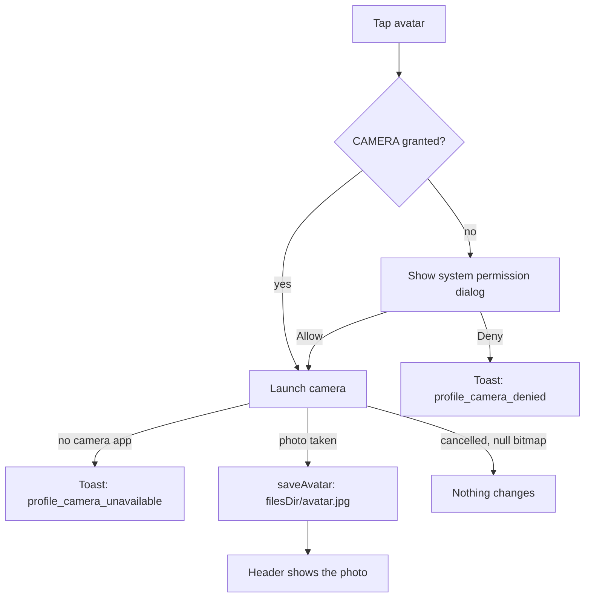

# Profile photo from the camera

The user taps the avatar on the Profile page. `ProfileRoute` checks whether the `CAMERA` permission is already granted. If it is, the camera opens straight away. If not, the system permission dialog is shown first. On "Allow" the camera opens, and on "Deny" a Toast explains why the permission is needed. If the device has no camera app, a second Toast says so instead of crashing. The camera returns a small preview `Bitmap`, which `ProfileViewModel` writes as a JPEG to `filesDir/avatar.jpg` and publishes through a `StateFlow`. The header shows that bitmap in the avatar circle. When the screen starts, `loadAvatar` reads the file back, so the photo survives app restarts.

## Files changed

| File | Change |
|---|---|
| `app/src/main/java/com/example/qamqorapp/MainActivity.kt` | provides `LocalActivityResultRegistryOwner` so the launchers work under the localized context |
| `app/src/main/AndroidManifest.xml` | `CAMERA` permission and optional camera feature |
| `app/src/main/res/values/strings.xml` | `profile_add_photo`, `profile_camera_denied` (EN) |
| `app/src/main/res/values-ru/strings.xml` | the same two strings (RU) |
| `app/src/main/java/com/example/qamqorapp/ui/profile/ProfileViewModel.kt` | `avatar` state, `loadAvatar`, `saveAvatar` |
| `app/src/main/java/com/example/qamqorapp/ui/profile/ProfileScreen.kt` | permission and camera launchers in `ProfileRoute`; clickable avatar with badge in `ProfileScreen` |

## 0. MainActivity: provide LocalActivityResultRegistryOwner

`rememberLauncherForActivityResult` finds its registry by looking up `LocalActivityResultRegistryOwner`, which by default walks `LocalContext` up to the hosting `Activity`. In this app `AppTheme` replaces `LocalContext` with `baseContext.localizedFor(language)`, a context made by `createConfigurationContext`. That context is not an `Activity`, so the lookup fails and opening Profile crashes with `IllegalStateException: No ActivityResultRegistryOwner was provided via LocalActivityResultRegistryOwner`. The fix is to provide the owner explicitly, from the activity, around the whole theme.

```kotlin
import androidx.activity.compose.LocalActivityResultRegistryOwner
```

```kotlin
setContent {
    CompositionLocalProvider(LocalActivityResultRegistryOwner provides this) {
        AppTheme(settings) {
            AppShell()
        }
    }
}
```

## 1. Manifest

`uses-feature` with `required="false"` keeps the app installable on devices without a camera. `uses-permission` declares `CAMERA`, which is a runtime (dangerous) permission, so it still has to be requested while the app runs.

```xml
<uses-feature android:name="android.hardware.camera" android:required="false" />

<uses-permission android:name="android.permission.CAMERA" />
```

## 2. Strings

One string is the accessibility label of the avatar button. The second is shown when the user denies the permission. The third is shown when no camera app can handle the request.

```xml
<string name="profile_add_photo">Change photo</string>
<string name="profile_camera_denied">Camera permission is needed to take a profile photo</string>
<string name="profile_camera_unavailable">No camera app available</string>
```

```xml
<string name="profile_add_photo">Изменить фото</string>
<string name="profile_camera_denied">Для фото профиля нужно разрешение на камеру</string>
<string name="profile_camera_unavailable">Нет приложения камеры</string>
```

## 3. ViewModel

The ViewModel holds the avatar as a read-only `StateFlow<Bitmap?>`. Disk work runs on `Dispatchers.IO`. `loadAvatar` returns early when an avatar is already in memory (so tab switches do not decode again) and only publishes when a file was found. `saveAvatar` compresses to JPEG (quality 90) into `avatar.jpg.tmp`, renames it over `avatar.jpg`, and publishes the bitmap only if the whole write succeeded, so a failed write never leaves a broken avatar. The constructor is unchanged.

```kotlin
private val _avatar = MutableStateFlow<Bitmap?>(null)
val avatar: StateFlow<Bitmap?> = _avatar

fun loadAvatar(dir: File) {
    if (_avatar.value != null) return
    viewModelScope.launch {
        val bitmap = withContext(Dispatchers.IO) {
            val file = File(dir, AVATAR_FILE)
            if (file.exists()) BitmapFactory.decodeFile(file.absolutePath) else null
        }
        if (bitmap != null) _avatar.value = bitmap
    }
}

fun saveAvatar(bitmap: Bitmap, dir: File) {
    viewModelScope.launch {
        val saved = withContext(Dispatchers.IO) {
            runCatching {
                val tmp = File(dir, "$AVATAR_FILE.tmp")
                tmp.outputStream().use { out ->
                    bitmap.compress(Bitmap.CompressFormat.JPEG, 90, out)
                }
                val target = File(dir, AVATAR_FILE)
                if (!tmp.renameTo(target)) {
                    target.delete()
                    check(tmp.renameTo(target))
                }
            }.isSuccess
        }
        if (saved) _avatar.value = bitmap
    }
}
```

and in the private companion object:

```kotlin
const val AVATAR_FILE = "avatar.jpg"
```

## 4. Route

`ProfileRoute` is the only place that knows about `Context`, the permission check and the activity-result launchers. `TakePicturePreview` needs no FileProvider because it returns a thumbnail `Bitmap`. A single `launchCamera` helper is used by both the permission callback and the tap handler. It catches `ActivityNotFoundException` and shows a Toast when there is no camera app. The screen only receives an `ImageBitmap` and a click callback. The block is the full function as it is in the file, including its original KDoc and comment lines.

```kotlin
/** Route: the only composable that knows [ProfileViewModel]. */
@Composable
fun ProfileRoute(
    onSignOut: () -> Unit,
    onOpenPost: (Long) -> Unit,
    modifier: Modifier = Modifier,
) {
    val viewModel = qamqorViewModel<ProfileViewModel>()
    val state by viewModel.uiState.collectAsStateWithLifecycle()
    val themeMode by viewModel.themeMode.collectAsStateWithLifecycle()
    val language by viewModel.language.collectAsStateWithLifecycle()
    val simulateError by viewModel.simulateError.collectAsStateWithLifecycle()
    // Only the route sees the Android context; the screen stays framework-free.
    val context = LocalContext.current
    val avatar by viewModel.avatar.collectAsStateWithLifecycle()
    val avatarImage = remember(avatar) { avatar?.asImageBitmap() }

    LaunchedEffect(Unit) { viewModel.loadAvatar(context.filesDir) }

    val cameraLauncher = rememberLauncherForActivityResult(
        ActivityResultContracts.TakePicturePreview(),
    ) { bitmap ->
        if (bitmap != null) viewModel.saveAvatar(bitmap, context.filesDir)
    }
    val launchCamera = {
        try {
            cameraLauncher.launch(null)
        } catch (e: ActivityNotFoundException) {
            Toast.makeText(context, R.string.profile_camera_unavailable, Toast.LENGTH_LONG).show()
        }
    }
    val permissionLauncher = rememberLauncherForActivityResult(
        ActivityResultContracts.RequestPermission(),
    ) { granted ->
        if (granted) {
            launchCamera()
        } else {
            Toast.makeText(context, R.string.profile_camera_denied, Toast.LENGTH_LONG).show()
        }
    }

    ProfileScreen(
        uiState = state,
        themeMode = themeMode,
        language = language,
        simulateError = simulateError,
        onOpenPost = onOpenPost,
        onSignOut = onSignOut,
        onSaveProfile = viewModel::saveProfile,
        onToggleResolved = viewModel::toggleResolved,
        onDeletePost = viewModel::delete,
        onSetTheme = viewModel::setTheme,
        onSetLanguage = { tag -> viewModel.setLanguage(tag, context) },
        onToggleSimulateError = viewModel::setSimulateError,
        avatar = avatarImage,
        onAvatarClick = {
            val granted = ContextCompat.checkSelfPermission(
                context,
                Manifest.permission.CAMERA,
            ) == PackageManager.PERMISSION_GRANTED
            if (granted) {
                launchCamera()
            } else {
                permissionLauncher.launch(Manifest.permission.CAMERA)
            }
        },
        modifier = modifier,
    )
}
```

## 5. Screen

Two new parameters with defaults, so the existing screenshot tests still compile:

```kotlin
modifier: Modifier = Modifier,
avatar: ImageBitmap? = null,
onAvatarClick: () -> Unit = {},
```

The avatar block. The inner `Box` is clipped to a circle, so the ripple is round, and it is the tap target (`onClickLabel`, `Role.Button`). It shows the photo or the placeholder icon, both with a content description so TalkBack announces them. The badge sits in the outer, unclipped `Box`, so the circle clip does not cut it off. Only `material-icons-core` is available, so the badge uses `Icons.Filled.Add`.

```kotlin
val addPhotoLabel = stringResource(R.string.profile_add_photo)
Box(modifier = Modifier.size(Dimens.ProfileAvatar.dp)) {
    Box(
        modifier = Modifier
            .fillMaxSize()
            .clip(CircleShape)
            .background(colors.amberSoft)
            .clickable(
                onClickLabel = addPhotoLabel,
                role = Role.Button,
                onClick = onAvatarClick,
            ),
        contentAlignment = Alignment.Center,
    ) {
        if (avatar != null) {
            Image(
                bitmap = avatar,
                contentDescription = addPhotoLabel,
                contentScale = ContentScale.Crop,
                modifier = Modifier.fillMaxSize(),
            )
        } else {
            Icon(
                imageVector = Icons.Filled.Person,
                contentDescription = addPhotoLabel,
                tint = colors.adoptInk,
                modifier = Modifier.size(32.dp),
            )
        }
    }
    Box(
        modifier = Modifier
            .align(Alignment.BottomEnd)
            .size(20.dp)
            .clip(CircleShape)
            .background(colors.pine),
        contentAlignment = Alignment.Center,
    ) {
        Icon(
            imageVector = Icons.Filled.Add,
            contentDescription = null,
            tint = colors.panel,
            modifier = Modifier.size(14.dp),
        )
    }
}
```

## Permission flow



```text
granted      -> camera -> save -> header
not granted  -> dialog -> Allow -> camera -> save -> header
                       -> Deny  -> Toast, nothing saved
no camera app (ActivityNotFoundException) -> Toast profile_camera_unavailable
```

## How to test

1. Run the app on an emulator or device with a camera, open the Profile tab.
2. Tap the avatar. The system dialog "Allow ... to take pictures?" appears. Tap Allow, and the camera opens. Take a photo and confirm it. The avatar circle now shows the photo.
3. Repeat with Deny. The Toast "Camera permission is needed to take a profile photo" appears and the avatar is unchanged.
4. Rotate the device. The photo stays.
5. Kill the app (swipe it away from recents) and start it again. The photo is loaded from `filesDir/avatar.jpg`.
6. To test the permission flow again, revoke the permission:
   - In Settings: Apps > Qamqor > Permissions > Camera > Don't allow.
   - Or with adb:

```text
adb shell pm revoke com.example.qamqorapp android.permission.CAMERA
```

On Android 11+ (API 30+), after two denials Android stops showing the dialog and the request returns "denied" immediately. Re-enable the permission in Settings to test again. On Android 10 and older the dialog keeps appearing until the user ticks "Do not ask again".

## Code prompts

Prompts to give an AI coding assistant, one per step. Each is written to be pasted as it is.

**MainActivity**

```text
In MainActivity.setContent wrap the existing AppTheme(settings) { AppShell() } call in
CompositionLocalProvider(LocalActivityResultRegistryOwner provides this) and import
androidx.activity.compose.LocalActivityResultRegistryOwner. The reason is that AppTheme replaces
LocalContext with a createConfigurationContext context, which is not an Activity, so
rememberLauncherForActivityResult would throw "No ActivityResultRegistryOwner was provided".
Change nothing else in MainActivity and add no code comments.
```

**Manifest**

```text
In app/src/main/AndroidManifest.xml add a uses-feature for android.hardware.camera with
android:required="false", and a uses-permission for android.permission.CAMERA. Put both above
the <application> tag. Do not change anything else.
```

**ViewModel**

```text
In ProfileViewModel (keep the constructor signature unchanged) add a private
MutableStateFlow<Bitmap?> named _avatar and a public read-only StateFlow<Bitmap?> named avatar.
Add loadAvatar(dir: File): on Dispatchers.IO decode File(dir, "avatar.jpg") with BitmapFactory
if it exists, and set _avatar when a bitmap was decoded; return early if _avatar already has a value.
Add saveAvatar(bitmap: Bitmap, dir: File): on Dispatchers.IO, inside runCatching, write the bitmap
as JPEG quality 90 to "avatar.jpg.tmp" and renameTo "avatar.jpg" (delete the target and retry if
the rename fails), and set _avatar only when that succeeded. Use
viewModelScope.launch and withContext. Keep the file name in a constant in the private
companion object. Do not add any code comments.
```

**Route and permission launcher**

```text
In ProfileRoute (ProfileScreen.kt) collect viewModel.avatar with collectAsStateWithLifecycle and
convert it with remember(avatar) { avatar?.asImageBitmap() }. Call
viewModel.loadAvatar(context.filesDir) in LaunchedEffect(Unit). Create a camera launcher with
rememberLauncherForActivityResult(ActivityResultContracts.TakePicturePreview()) that calls
viewModel.saveAvatar(bitmap, context.filesDir) for a non-null bitmap. Create a permission launcher
with ActivityResultContracts.RequestPermission(): if granted launch the camera, otherwise show a
Toast with R.string.profile_camera_denied. Pass onAvatarClick to ProfileScreen: if
ContextCompat.checkSelfPermission(context, Manifest.permission.CAMERA) is PERMISSION_GRANTED
launch the camera directly, else launch the permission request. Pass avatar = the ImageBitmap.
Route every camera launch through one launchCamera helper that wraps cameraLauncher.launch(null)
in try/catch(ActivityNotFoundException) and shows a Toast with R.string.profile_camera_unavailable.
Do not add any code comments.
```

**Screen UI**

```text
In ProfileScreen add two parameters after modifier, both with defaults so screenshot tests still
compile: avatar: ImageBitmap? = null and onAvatarClick: () -> Unit = {}. Rework the avatar in the
header: an outer, unclipped Box of Dimens.ProfileAvatar size. Inside it, a Box that fills the
size, is clipped to CircleShape, has the amberSoft background and is clickable with
onClickLabel = stringResource(R.string.profile_add_photo), role = Role.Button and
onClick = onAvatarClick; show Image(bitmap = avatar, contentScale = ContentScale.Crop,
fillMaxSize) when avatar is not null, otherwise the existing Icons.Filled.Person, both with
contentDescription = the same label. Also inside the outer Box add a 20.dp circular badge aligned BottomEnd with
colors.pine background and an Icons.Filled.Add icon tinted colors.panel. Use only
material-icons-core icons. Do not add any code comments.
```

**Strings**

```text
Add three strings to values/strings.xml and values-ru/strings.xml. profile_add_photo: "Change photo"
and "Изменить фото". profile_camera_denied: "Camera permission is needed to take a profile photo"
and "Для фото профиля нужно разрешение на камеру". profile_camera_unavailable: "No camera app
available" and "Нет приложения камеры". Add them at the end of the resources block.
```
