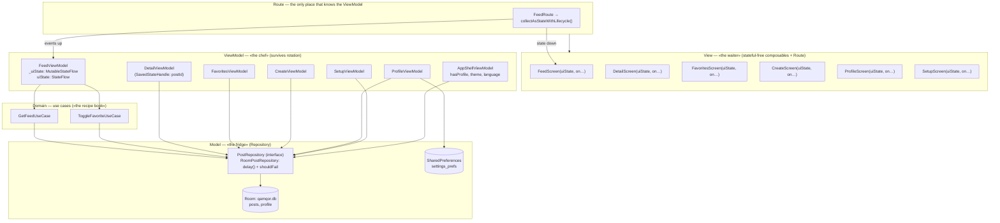

# Qamqor — architecture (SIS 4)

*Part A of the assignment: the "restaurant" picture with our own names, the order
board (UiState fields), the events, where the data lives, and a trace of one click.*

Unlike the screen sketches (`01`–`06`), this diagram is about **who owns what**,
not about pixels.

## The restaurant



ASCII version (if the Mermaid block does not render):

```
  EVENTS (up)                                   STATE (down)
  onQueryChange ─┐                         ┌─ FeedUiState
  onFavouriteClick├─► FeedRoute ─► FeedViewModel ─► FeedScreen(uiState, …)
  onRetry ───────┘      │            _uiState (private)
                        │            uiState   = asStateFlow()  (public)
                        └─ GetFeedUseCase / ToggleFavoriteUseCase
                                      │
                              PostRepository
                          (RoomPostRepository: delay + shouldFail)
                                      │
                              qamqor.db (Room)  +  settings_prefs
```

## Screens → ViewModel

| Screen (View) | ViewModel | UiState |
|---|---|---|
| `ui/feed/FeedScreen.kt` | `FeedViewModel` | `FeedUiState` |
| `ui/detail/DetailScreen.kt` | `DetailViewModel` | `DetailUiState` |
| `ui/favorites/FavoritesScreen.kt` | `FavoritesViewModel` | `FavoritesUiState` |
| `ui/create/CreateScreen.kt` | `CreateViewModel` | `CreateUiState` |
| `ui/profile/ProfileScreen.kt` | `ProfileViewModel` | `ProfileUiState` |
| `ui/setup/SetupScreen.kt` | `SetupViewModel` | `SetupUiState` |
| `ui/navigation/AppShell.kt` | `AppShellViewModel` | `hasProfile`, `themeMode`, `language` |

## Order board — the fields of each UiState

`FeedUiState` (the main screen, all `val`):

| Field | Meaning |
|---|---|
| `query: String` | search text (survives rotation) |
| `filters: FeedFilters` | `status`, `species`, `district` |
| `posts: List<Post>` | the content |
| `activeCount: Int` | the "N active posts" counter |
| `isLoading: Boolean` | **loading** |
| `errorMessage: String?` | **error** when non-null |

Derived situations: `hasError`, `isEmpty`, `isContent`, `isFiltered`.

Other screens: `DetailUiState(post, author, isLoading, missing)`,
`CreateUiState(status, species, emoji, name, … , isSaving, published)`,
`ProfileUiState(profile, myPosts, published, resolved, favorites, isLoading)`,
`SetupUiState(name, phone, nameError, phoneError, isSaving, done)`.

## Events (user actions handled in the ViewModel)

- `onQueryChange(String)` — search by text
- `selectStatus(PostStatus?)` — the «Все / Потеряно / Найдено / Пристройство» segments
- `toggleSpecies(Species)` / `selectDistrict(District?)` — the chip filters
- `onFavouriteClick(Post)` — toggle a favourite
- `onRetry()` — reload after the error state
- `clearFilters()` — reset search + filters from the empty state

## Repository (where the data lives)

- `data/PostRepository.kt` — the interface the ViewModels depend on.
- `data/RoomPostRepository.kt` — the implementation:
  - `delay(600)` on every read (`simulateNetwork`) and `IOException` when
    `shouldFail == true` (toggled from **Profile → Settings → Demo: simulate error**).
- `data/QamqorDatabase.kt` — Room database `qamqor.db` (tables `posts`, `profile`).
- `data/SettingsRepository.kt` — SharedPreferences `settings_prefs` (theme, language).

## Trace one click

The user taps the star on a card in the feed:

1. `FeedScreen` has no logic — the star calls the lambda `onFavouriteClick(post)`.
2. That lambda is `FeedViewModel::onFavouriteClick` (wired in `FeedRoute`).
3. `FeedViewModel.onFavouriteClick` launches `ToggleFavoriteUseCase(post)`.
4. The use case calls `PostRepository.toggleFavorite(post)` →
   `RoomPostRepository` runs `UPDATE posts SET isFavorite = …` on Room.
5. Room re-emits `observeFeed(...)`; `FeedViewModel.loadFeed` maps it to
   `FeedResult.Content`, and `render()` writes a **new** `FeedUiState` with
   `_uiState.update { it.copy(posts = …) }`.
6. `FeedRoute`'s `collectAsStateWithLifecycle()` sees the new value; `FeedScreen`
   recomposes with the filled/empty star. The same `PostCard` also updates on the
   Favorites and Detail screens, because they observe the same table.
